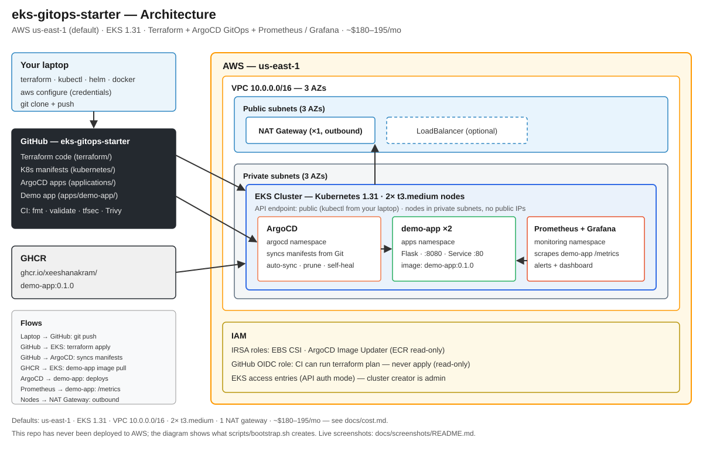
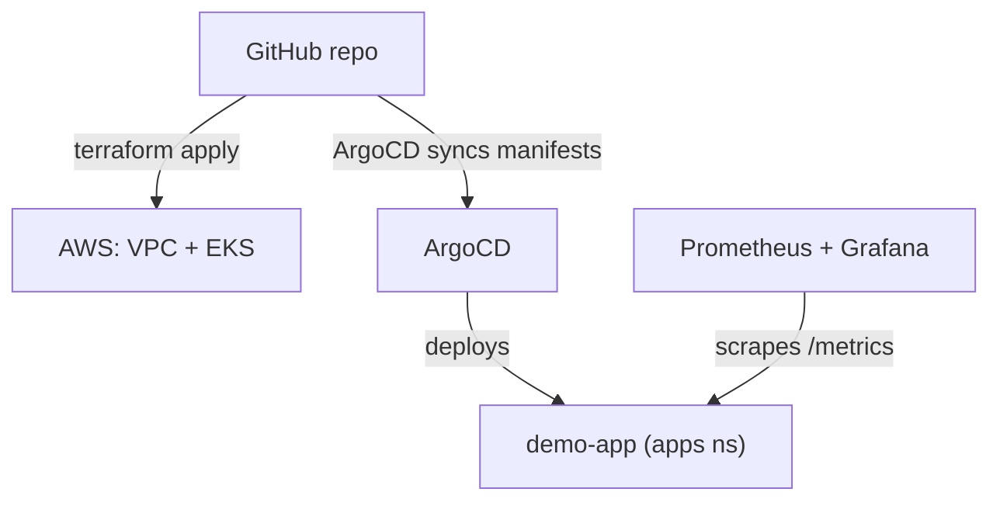

# eks-gitops-starter

[](LICENSE)
[](terraform/)
[](kubernetes/)
[](kubernetes/argocd/)
[](https://github.com/XEESHANAKRAM/eks-gitops-starter/actions)

> **A production-ready EKS platform in one repo: Terraform builds the cluster, ArgoCD deploys your apps from Git, and Prometheus + Grafana watch everything — so a small team can run Kubernetes the way big teams do, without the big-team setup time.**

## What you get

| Piece | What it does |
| ----- | ------------ |
| **Terraform** | VPC (3 AZs, private subnets, NAT), EKS 1.31 + managed node group, EKS add-ons (VPC CNI, CoreDNS, kube-proxy, EBS CSI), IRSA roles |
| **ArgoCD** | GitOps: push to Git and the cluster converges — automated sync, prune, self-heal |
| **ApplicationSet** | Add a new app with one list entry, no new YAML files |
| **Monitoring** | kube-prometheus-stack with alert rules (app down, no traffic, high latency, crash-looping) and a Grafana dashboard |
| **Demo app** | A small Flask app with `/metrics` that proves the whole flow end to end |
| **CI** | Terraform fmt/validate/plan, tfsec, Trivy image scan, YAML lint — on every PR |

## Architecture





Full diagram and design decisions: [`docs/architecture.md`](docs/architecture.md).
Visual step-by-step run guide: [`docs/run-guide.md`](docs/run-guide.md).

## Quickstart

```bash
git clone https://github.com/XEESHANAKRAM/eks-gitops-starter.git
cd eks-gitops-starter
cp terraform/terraform.tfvars.example terraform/terraform.tfvars
./scripts/bootstrap.sh
```

Takes ~30 minutes (mostly the EKS control plane). Step-by-step with
expected output: [`docs/quickstart.md`](docs/quickstart.md). Visual
run guide with expected output for every step:
[`docs/run-guide.md`](docs/run-guide.md).

Then verify:

```bash
kubectl get pods -n apps
kubectl port-forward svc/demo-app -n apps 8081:80
curl http://localhost:8081/
# {"app":"demo-app","message":"Hello from eks-gitops-starter!", ...}
```

## Cost

Default setup (2× t3.medium, 1 NAT gateway) runs about **$180–195/month**
in `us-east-1`. Full breakdown and ways to cut it:
[`docs/cost.md`](docs/cost.md). Destroy everything with
`./scripts/destroy.sh`.

## Security

Private subnets, IRSA roles scoped per service account, EKS API
authentication mode, read-only CI role (CI can `plan`, never `apply`),
tfsec + Trivy scans, no hardcoded secrets. Details and what you must do
yourself: [`docs/security.md`](docs/security.md).

## Docs

| Guide | What it covers |
| ----- | -------------- |
| [`docs/quickstart.md`](docs/quickstart.md) | Install end to end, with expected results |
| [`docs/run-guide.md`](docs/run-guide.md) | Visual how-to-run guide, expected output per step, real local demo run |
| [`docs/architecture.md`](docs/architecture.md) | Diagram, components, design decisions |
| [`docs/cost.md`](docs/cost.md) | Cost estimate and how to reduce it |
| [`docs/security.md`](docs/security.md) | Security model and your responsibilities |
| [`docs/customization.md`](docs/customization.md) | Add apps, change region/size, expose the demo app, ECR + Image Updater |
| [`docs/troubleshooting.md`](docs/troubleshooting.md) | Common failures and fixes |
| [`CONTRIBUTING.md`](CONTRIBUTING.md) | How to contribute |

## Who this is for

- **DevOps engineers** who want a clean, working EKS + GitOps reference
  they can clone and adapt instead of assembling it from blog posts.
- **Small teams** that need a production-shaped platform without hiring
  a platform team.
- **Learners** who want to see the whole flow — Terraform, GitOps,
  observability — in one coherent repo, not scattered tutorials.

## Honest notes

- This is a **starter/boilerplate**, not a managed service. It is built
  from public best practice and tested for syntax/validation (see below),
  but you own the cluster you create with it.
- No claims are made about production users, downloads, or
  certifications — there are none yet. If you use it, tell us how it
  went (open an issue).

## Validation status

- `terraform fmt` and `terraform validate` pass (Terraform 1.9.8, modules
  and providers downloaded at validation time).
- All YAML files parse cleanly.
- The demo app is a real Flask app; the image builds with Docker.
- What was **not** tested here: a live `terraform apply` against AWS
  (that costs money and needs your credentials) and a live cluster run.
  The quickstart is written so you can verify it yourself.

## Contributing

See [`CONTRIBUTING.md`](CONTRIBUTING.md). Bug reports and small,
focused PRs are welcome.

## License

[MIT](LICENSE) — free and open source. Copyright (c) 2026 Zeeshan Akram.
