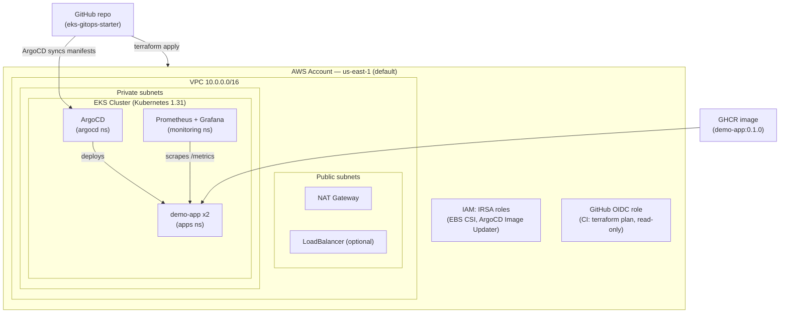

# Architecture

## Diagram

## Components

| Component | What it is | Where it lives |
| --------- | ---------- | -------------- |
| VPC | 3 AZs, public + private subnets, 1 NAT gateway (default) | `terraform/vpc.tf` |
| EKS | Managed control plane, 1 managed node group (2× t3.medium default) | `terraform/eks.tf` |
| Add-ons | VPC CNI, CoreDNS, kube-proxy, EBS CSI driver | `terraform/eks.tf` (`cluster_addons`) |
| IRSA | OIDC provider + roles for EBS CSI and ArgoCD Image Updater | `terraform/iam.tf` |
| ArgoCD | GitOps controller, installed by Helm | `kubernetes/argocd/` |
| ApplicationSet | Generates one Application per app in its list | `kubernetes/argocd/applications/demo-appset.yaml` |
| Monitoring | kube-prometheus-stack (Prometheus, Grafana, Alertmanager) | `kubernetes/monitoring/` |
| Alerts | DemoAppDown, DemoAppNoTraffic, DemoAppHighLatency, PodCrashLooping, PodNotReady | `kubernetes/monitoring/alert-rules.yaml` |
| Dashboard | Grafana "Demo App" dashboard (requests, latency, CPU, memory) | `kubernetes/monitoring/dashboard-demo-app.json` |
| Demo app | Flask app with `/`, `/healthz`, `/metrics` | `apps/demo-app/` |
| CI | Terraform fmt/validate/plan, tfsec, Trivy, YAML lint | `.github/workflows/ci.yml` |

## How the pieces fit together

1. **Terraform** creates the network, the cluster, and the IAM roles.
   Nothing else in the repo assumes AWS resources that Terraform did not
   create — the cluster name, VPC, and subnets all come from Terraform
   outputs.
2. **ArgoCD** is installed by Helm, then told to watch this repo. The
   root Application (`kubernetes/argocd/applications/root.yaml`) syncs the
   applications directory; the ApplicationSet in that directory generates
   one Application per app (today: `demo-app`).
3. **The demo app** is deployed by ArgoCD from `apps/demo-app/k8s`. Its
   ServiceMonitor tells Prometheus to scrape `/metrics`.
4. **Prometheus + Grafana** observe the cluster and the app. The alert
   rules and the dashboard ship in the repo, so monitoring is versioned
   like everything else.

## Design decisions

- **Private subnets for nodes.** Worker nodes have no public IPs; outbound
  traffic goes through the NAT gateway. The EKS API endpoint is reachable
  publicly (for `kubectl` from your laptop) and privately from the VPC.
- **API authentication mode.** Access entries, not the `aws-auth`
  ConfigMap — the modern AWS approach. The cluster creator gets admin
  automatically.
- **Single NAT gateway by default.** Saves ~$32/month. Set
  `single_nat_gateway = false` for production HA (see `docs/cost.md`).
- **ArgoCD automated sync with prune + self-heal.** The cluster converges
  to Git. If someone edits a resource by hand, ArgoCD puts it back.
- **CI is read-only on AWS.** The GitHub OIDC role can only run
  `terraform plan`. Applies are a deliberate human action
  (see `docs/security.md`).
